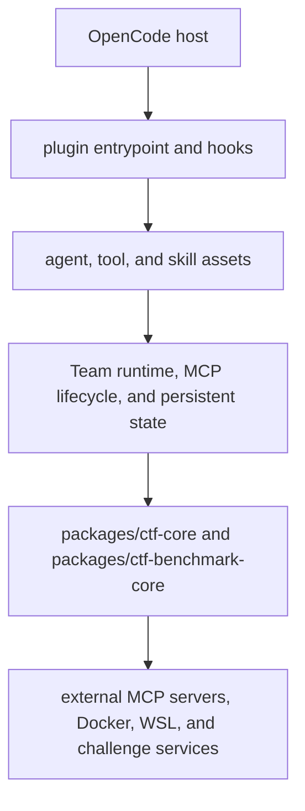
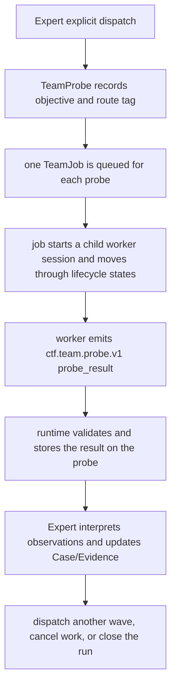

# Architecture Baseline

This document describes the current architecture. Source code is authoritative for behavior; the four architecture and planning documents use the same Team runtime model described here.

## 1. Product boundary

`opencode-for-ctf` is an OpenCode plugin for authorized CTF competitions, training ranges, benchmarks, and local challenge environments. The package provides agents, commands, skills, tools, Team Mode lifecycle management, MCP lifecycle management, and state persistence.

The plugin exposes OpenCode hooks and tools. The runtime is organized as:



The dependency direction is from `src/`, `tools/`, and `scripts/` into the shared packages. The shared packages do not depend back on the plugin runtime.

## 2. Agent surface

The primary user-selectable solving agents are `ctf-fast` and `ctf-expert`. `researcher` is a user-invoked support agent for post-solve learning and local knowledge maintenance. Category agents (`ctf-web`, `ctf-pwn`, `ctf-rev`, `ctf-crypto`, `ctf-forensics`, `ctf-misc`, and `ctf-aisec`) and meta agents are subagent surfaces.

The fast and expert lanes are independent. A fast-lane blocker is reported to the user; Team Mode and the expert lane are not entered automatically.

## 3. State and evidence ownership

The Team runtime persists schema-versioned state in `.ctf-team.json`. The current state shape is `schemaVersion: 2` with runs containing explicit `probes` and `jobs` arrays. Unsupported older Team state is quarantined and replaced with an empty current state; it is not migrated into the Probe model.

Case and Evidence decisions belong to the Expert. Case events may receive a best-effort audit mirror of Team lifecycle events, but the worker does not write Case or Evidence state. The Evidence board and rendered Team board are projections for observation and review; they are not independent reasoning ledgers.

Independent flag, file, or service oracles remain the only source of `oracle-verified` solve status. Worker output, route status, board text, and candidate formatting cannot substitute for an oracle.

## 4. Team Mode runtime

Team Mode has one canonical runtime model:



A `TeamProbe` contains the investigation input and result:

- `title` and `objective` describe the bounded investigation;
- `agent` selects the worker agent;
- `routeId` is a scheduling and display tag (`recon`, `R1`, `R2`, `R3`, or `general`);
- `concurrency` is `independent` or `shared_state`;
- `status` is the probe-level state;
- `result`, when present, is the validated `ProbeResult`.

A `TeamJob` contains lifecycle and session data and points to exactly one probe through `probeId`. Its statuses cover queueing, startup, running, retrying, completion, failure, cancellation, interruption, and orphan handling. A job is an execution record, not a second decision model.

The runtime is split at five internal seams. `src/team/team-worker-packet.ts` owns worker-message cursors, bounded raw output, and `ctf.team.probe.v1` collection. `src/team-reducer.ts` owns the canonical job status set and transitions, Probe synchronization, run-status derivation, notification readiness, retry-reservation/replacement/startup/recovery state transitions, and per-job cancellation outcomes. `src/team/team-cancellation-cleanup.ts` owns the bounded I/O recovery loop for follow-up/replacement session aborts; it rechecks persisted session IDs under the state lock and marks non-convergent cleanup as degraded. `src/team-adoption-reducer.ts` owns pure orphan-job replacement migration and parent rebind audit/state updates, including bounded adoption history; it does not create, abort, or prompt sessions. The runtime's internal `promptWorkerSession` seam owns the shared worker prompt/tool-surface injection used by dispatch, deadline retry, and orphan adoption; session creation, MCP activation, owner fencing, persistence, parent-presence checks, and failure recovery remain in their lifecycle callers. `src/team/team-runtime-core.ts` owns client I/O, persistence, lifecycle orchestration, recovery ordering, route filtering, and whole-run cancellation policy; it does not duplicate packet parsing, retry state transitions, follow-up abort convergence, adoption state migration, or per-job cancellation rules. `src/team/team-state.ts` keeps only compatibility re-exports for older callers.

The worker prompt is intentionally small: it names the worker, run, probe, objective, route, concurrency, tool restrictions, Case/Evidence boundary, artifact return rule, and result protocol. It does not provide a state digest or ask the worker to maintain shared reasoning state.

The only worker result protocol is:

```json
{
  "protocol": "ctf.team.probe.v1",
  "type": "probe_result",
  "status": "completed",
  "summary": "short result summary",
  "observations": [
    {
      "kind": "observation",
      "statement": "bounded finding",
      "evidence": [{"type": "command", "value": "..."}]
    }
  ],
  "artifacts": ["work/solve.py"],
  "next": "optional Expert-facing next step"
}
```


The parser accepts the newest valid fenced packet and applies size and shape limits. A malformed fenced packet, failed packet, or missing packet is a worker collection failure; it does not create a decision record.

The lifecycle runtime retains the operational controls that protect child sessions and shared state:

- per-job deadlines, heartbeat tracking, bounded retries, and timeout replacement;
- explicit cancellation, route cancellation, and close operations;
- restart recovery, orphan inspection, explicit adoption, and repair/quarantine;
- file locking, atomic JSON updates, revision increments, owner tokens, and fencing;
- stale-session rejection so a late worker cannot overwrite a replacement job;
- parent-session cleanup and bounded run retention;
- audit events mirrored to the associated Case when available.

The independent flag oracle remains separate from these lifecycle controls. A successful worker packet means only that the probe reported a result; it does not close the challenge.

## 5. Tool registration

The tool registry discovers files under `tools/`, excludes `tools/lib` helpers, applies pack filtering, and uses `ctf-agent.manifest.json` `registered_tools` as the explicit product whitelist when the manifest is available. Files present on disk but outside that list are reported as undeclared and are not registered. Team lifecycle tools are runtime tools and are listed separately from disk-backed tools in the manifest.

Tool metadata distinguishes ordinary tools, specialist tools, and maintenance tools. Each tool has one canonical name: compatibility aliases and facades are not part of the registered surface. `ctf-safe-extract` is the archive implementation. The registry report records registered, deferred, undeclared, quarantined, and failed entries.

## 6. Testing and benchmarks

The repository uses deterministic unit and integration tests for state, locks, installers, tool behavior, and Team lifecycle. Benchmark entrypoints are separated by purpose:

- `benchmark:lint` runs family rule checks and reports process-level diagnostics;
- `benchmark:replay` runs deterministic scenario contracts and replay checks;
- `benchmark:solve` runs the NYU-style challenge runner with isolated workspaces and an independent oracle.

Replay and lint results are not solve-rate measurements. Solve rate is based on the independent challenge oracle; structured observations, artifacts, and replay status are diagnostic dimensions.

The current CI workflow runs on Ubuntu and Windows with Node 22 and includes type/lint checks, content validation, formatting, tests, benchmark replay, plugin build, and release-package verification. Coverage runs in a separate Ubuntu job.

## 7. Compatibility and source-dependent uncertainty

The package manifest pins `@opencode-ai/plugin` and `@opencode-ai/sdk` to
`1.19.4`. The compatibility policy
is exact: verified against OpenCode 1.19.4; OpenCode 1.18.x is unverified; and
OpenCode 2.x is unsupported. OpenCode does not expose a supported host-version
API, so startup, status, and doctor diagnostics report the pinned plugin/SDK
versions and policy while leaving an unknown host version non-fatal.

The `OPENCODE_VERSION` environment variable is not used as host-version proof.
Deployments may record an explicit version hint outside the plugin, but the
plugin does not infer compatibility from undocumented environment variables.

The runtime contract is the explicit Probe/Job state and `ctf.team.probe.v1` collection path. Historical tool aliases, deprecated agents, and compatibility façade modules have been removed; new code imports the canonical module or tool directly.
