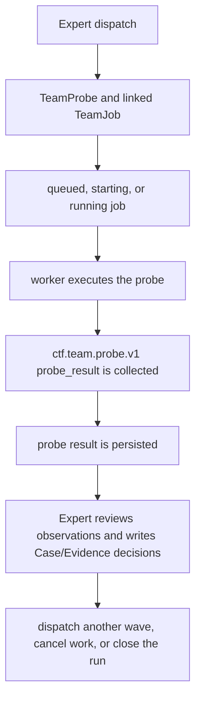

# Team Mode Information Flow

This document records the current Probe runtime and the information boundaries around it. It is a factual implementation reference, not a proposal for a second Team architecture.

## 1. Canonical model

A Team run is created by an explicit Expert dispatch. The dispatch request contains a wave title and one or more probes. Each probe specifies `title`, `objective`, `agent`, `routeId`, and optional `concurrency` (`independent` or `shared_state`). The runtime creates one `TeamProbe` and one `TeamJob` for each request.



`routeId` is a scheduling and display tag. It is not an evidence ledger, claim owner, or reasoning state. `TeamJob` is the child-session lifecycle record; `TeamProbe` is the bounded investigation and its result. There is no Fact/Intent ledger, claim-next flow, or worker-owned decision state in the canonical model.

The current persisted Team state is `.ctf-team.json` with `schemaVersion: 2`. Unsupported legacy Team state is quarantined rather than migrated. The quarantine keeps the old file for inspection and starts an empty Probe state.

## 2. Ownership and information boundaries

The Expert owns decisions and Case/Evidence writes. The worker is an isolated observer and executor:

- it may inspect the authorized challenge scope and create local artifacts;
- it may not use Team control tools or write Case/Evidence state;
- it returns observations and evidence references for Expert interpretation;
- it does not assert a confirmed case decision or solve status.

The worker prompt contains the run and probe identity, objective, route tag, concurrency mode, authorized scope, artifact return rule, and packet contract. It intentionally does not contain a state digest. Shared reasoning state remains with the Expert and the Case/Evidence projections.

The board and rendered Team status are observability projections. They summarize probes, jobs, statuses, route tags, results, artifacts, and lifecycle diagnostics. They are not a reasoning ledger and do not independently determine the next action.

## 3. Probe and job data

The relevant Probe fields are:

```ts
TeamProbe = {
  id,
  title,
  objective,
  agent,
  routeId,
  concurrency: "independent" | "shared_state",
  status,
  result?
}
```

A result is:

```ts
ProbeResult = {
  protocol: "ctf.team.probe.v1",
  type: "probe_result",
  status: "completed" | "blocked" | "failed",
  summary,
  observations: Array<{
    kind,
    statement,
    evidence: Array<{ type, value }>
  }>,
  artifacts: string[],
  next?
}
```

Observation kinds are `observation`, `measurement`, `artifact`, `error`, `negative`, and `candidate`. Evidence references are typed as `command`, `file`, `response`, `hash`, or `trace`. The parser and persisted-state validator enforce bounded counts and lengths.

A job points to one probe with `probeId` and carries session, timeout, heartbeat, retry, cancellation, fencing, cursor, raw-result, and error details. The job lifecycle includes `queued`, `starting`, `running`, `retrying`, `completed`, `failed`, `cancelled`, `cancel_failed`, `interrupted`, and `orphaned`.

## 4. Collection path

Collection crosses two internal seams. `src/team/team-worker-packet.ts` reads worker assistant messages after the job cursor, extracts fenced JSON blocks, selects the newest valid `ctf.team.probe.v1` packet, and retains a bounded raw result for diagnostics. A malformed fenced packet rejects collection rather than being silently skipped; the packet is validated before it is attached to the probe.

`src/team-reducer.ts` owns the pure state consequences of collection and lifecycle events: job transitions, job-to-probe synchronization, run-status derivation, notification readiness, and retry-reservation cleanup. `src/team/team-runtime-core.ts` supplies client I/O and persistence around those seams.

A valid completed or blocked packet completes the lifecycle job and stores the packet as `probe.result`; its status becomes the probe status. A `failed` packet, missing probe, malformed packet, collection error, or worker error fails the job and does not produce an accepted decision. The message cursor is persisted on the job so subsequent collection can avoid reprocessing already collected assistant messages.

The runtime emits flat Team lifecycle events for probe creation, start, completion, blocked results, failure, and cancellation. Events are audit records and may be mirrored to the run's Case event stream. They are not alternate write paths for state or Expert decisions.

## 5. Expert sequence

The current sequence is:

1. The Expert initializes or reads the applicable Case/Evidence context and chooses distinct route tags for the wave.
2. The Expert explicitly dispatches bounded probes with objectives, agents, route tags, and concurrency modes.
3. The runtime creates child sessions, applies the shared worker prompt/tool-surface injection, activates the selected MCP profile, starts jobs, and tracks deadlines and heartbeats.
4. Workers execute only their assigned probe and return one structured result packet.
5. The runtime collects and validates packets, persists probe results, updates job and run status, and records lifecycle audit events.
6. The Expert reads the collected observations and artifacts, decides what they mean, and writes accepted Case/Evidence decisions through the existing Expert-owned tools.
7. The Expert either dispatches another explicit wave, cancels irrelevant routes, or closes the run with an outcome and synthesis summary.

A worker's `next` field is advisory input to the Expert. It does not enqueue work or mutate Case/Evidence state automatically. A route tag is likewise a scheduling/display label; route meaning and closure decisions remain Expert-owned.

## 6. Lifecycle controls retained

Probe collection does not replace the existing lifecycle supervisor. The runtime continues to provide:

- per-worker timeout and deadline evaluation;
- bounded retry and replacement after an expired running worker;
- retry reservation, replacement registration, startup failure, running commit, and restart recovery state transitions in `src/team-reducer.ts`, with client abort/create/MCP/prompt I/O remaining in the runtime orchestrator;
- cancellation and cancellation retry, including `cancel_failed` handling;
- route cancellation and close guards;
- per-job cancellation state reduction in `src/team-reducer.ts`;
- bounded follow-up/replacement session abort convergence in `src/team/team-cancellation-cleanup.ts`, while client abort initiation, route filtering, and whole-run active-state policy remain in `src/team/team-runtime-core.ts`;
- pure orphan-job replacement migration and parent-session rebind audit updates in `src/team-adoption-reducer.ts`, while orphan/parent presence validation and all session lifecycle I/O remain in `src/team/team-runtime-core.ts`;
- restart recovery and reconciliation with child sessions;
- orphan detection, quarantine, explicit adoption, and repair;
- parent-session cleanup;
- file-lock and atomic-update serialization;
- revision, owner-token, and session fencing;
- stale-result rejection and bounded raw diagnostics;
- best-effort Case audit mirroring that cannot make Team collection fail.

Recovery never treats an unknown or missing session as a valid completed probe. Adoption records an explicit audit trail and does not reuse the old child session.

## 7. Protocol example

```json
{
  "protocol": "ctf.team.probe.v1",
  "type": "probe_result",
  "status": "blocked",
  "summary": "The local service is unavailable in the authorized workspace.",
  "observations": [
    {
      "kind": "error",
      "statement": "The service process exited before accepting a connection.",
      "evidence": [
        {"type": "command", "value": "./run.sh"},
        {"type": "response", "value": "exit code 1"}
      ]
    }
  ],
  "artifacts": [],
  "next": "Expert should select an available local path or record the blocker."
}
```

The result describes an observation. It does not claim that a route is dead, prove a flag, or write a Case conclusion.

## 8. Current limits and backlog

The implementation intentionally keeps the worker packet bounded and the worker context minimal. Remaining work should stay limited to verified gaps, including any needed cleanup of historical compatibility wording or tests that still mention the retired model. No migration from the old Team state is planned.

The exact external OpenCode SDK behavior for every recovery edge is not established by these documents. Runtime recovery is fail-closed where session presence is unknown, and any stronger guarantee requires source-level or integration evidence.
